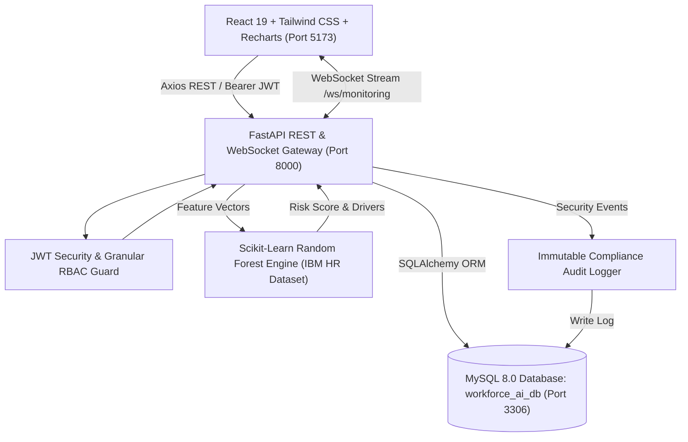

# WorkForce AI Pro — HR Attrition Prediction & Workforce Intelligence Platform

[](https://python.org)
[](https://fastapi.tiangolo.com)
[](https://react.dev)
[](https://vitejs.dev)
[](https://mysql.com)
[](https://scikit-learn.org)
[](https://tailwindcss.com)
[](https://pytest.org)

> **WorkForce AI Pro** is an enterprise-grade full-stack HR Management System (HRMS) coupled with a machine-learning flight-risk attrition prediction engine, automated retention intervention workflows, biometric shift tracking, payroll compliance, and real-time security governance.

---

## 📋 Table of Contents
1. [Platform Architecture](#-platform-architecture)
2. [Technology Stack](#-technology-stack)
3. [The Core Expected Flow (AI Simulation)](#-the-core-expected-flow-ai-simulation)
4. [Complete 30-Module Coverage](#-complete-30-module-coverage)
5. [Database Schema (15 Relational Tables)](#-database-schema-15-relational-tables)
6. [Role-Based Access Control (RBAC)](#-role-based-access-control-rbac)
7. [Installation & Setup Guide](#-installation--setup-guide)
8. [API Documentation (Swagger UI)](#-api-documentation-swagger-ui)
9. [Automated Testing (Pytest Suite)](#-automated-testing-pytest-suite)
10. [Default Demo Credentials](#-default-demo-credentials)
11. [Deliverables Verification Matrix](#-deliverables-verification-matrix)

---

## 🏛 Platform Architecture



---

## 💻 Technology Stack

| Layer | Technologies |
| :--- | :--- |
| **Backend Framework** | **FastAPI** (Python 3.11), Uvicorn ASGI Server, Starlette |
| **Database & ORM** | **MySQL 8.0**, SQLAlchemy 2.0 ORM, PyMySQL driver, Pydantic v2 `ConfigDict` |
| **Authentication & Security** | OAuth2 Bearer Tokens, JWT (HS256 algorithm), Passlib (Bcrypt hashing) |
| **Machine Learning & AI** | **Scikit-Learn** (Random Forest Classifier & Feature Importance), Pandas, NumPy |
| **Frontend Framework** | **React 19**, Vite, JavaScript (ES2023), Tailwind CSS v4 |
| **Visualizations & Charts** | **Recharts**, Lucide React Icons |
| **Testing & Quality** | **Pytest**, AnyIO, FastAPI TestClient, 100% Green test suite |

---

## 🔄 The Core Expected Flow (AI Simulation)

The platform implements the exact event-driven predictive workforce lifecycle required by enterprise operations:

```
[Employee Activity Update] (Overtime / Shift / Tenure / Job Role)
                │
                ▼
[AI Prediction Engine Recalculation] (Random Forest Inference)
                │
                ▼
[High-Risk Flight Anomaly Detected] (Risk Score > 60%, Primary Driver Identified)
                │
                ▼
[Smart HR Escalation Alert Triggered] (Red Alert Badge in Top Navbar)
                │
                ▼
[Retention Intervention Workflow Initiated] (Action Plan: Bonus / WFH / Promotion)
                │
                ▼
[Real-Time Audit Trail Logging] (Immutable event stored with User ID, IP, Action)
                │
                ▼
[Workforce Analytics Dashboard Refreshed] (Metrics & Headcount Forecast Updated)
```

---

## 📦 Complete 30-Module Coverage

### Phase 1: Core HRMS Operations (Modules 1–10)
* **Module 1: Authentication & Authorization** — Secure JWT authentication, password resets, refresh tokens, active session validation.
* **Module 2: Employee Management System** — Comprehensive directory, personal details, contact info, job roles, salary bands, and statuses.
* **Module 3: Department & Role Management** — Organizational hierarchy, department codes, budget centers, and employee distribution.
* **Module 4: Attendance & Shift Management** — Biometric check-in/out timestamps, morning/evening shifts, working hours, and overtime computation.
* **Module 5: Leave Management System** — Annual, Sick, Casual, and Unpaid leave workflows with balance counters and manager approvals.
* **Module 6: Payroll Management System** — Automated monthly salary calculation: Basic, HRA, Allowances, Tax deduction, PF, and digital payslips.
* **Module 7: Notifications & Alerts System** — Real-time notification center with category filtering (All, Leaves, Payroll, Risk Alerts).
* **Module 8: One-to-One Communication** — Direct peer-to-peer workplace messaging with unread status tracking.
* **Module 9: Document Management Vault** — Centralized repository for employment contracts, government IDs, and compliance records.
* **Module 10: Dashboard & Workforce Analytics** — Executive KPI summary cards, headcount distribution charts, and recent activity streams.

### Phase 2: AI Attrition Prediction & Intelligence (Modules 11–18)
* **Module 11: Dataset Management System** — IBM HR Analytics dataset upload, schema validation, version control, and data distribution preview.
* **Module 12: AI Attrition Prediction Engine** — Random Forest model calculating flight risk percentages, confidence ratings, and top risk factors.
* **Module 13: Continuous Employee Risk Monitoring** — Automated risk scoring and tier categorization (LOW, MEDIUM, HIGH, CRITICAL).
* **Module 14: Workforce Retention Forecasting** — Predictive timeline forecasting headcount and retention rates over 3, 6, and 12-month horizons.
* **Module 15: Attrition Analytics Dashboard** — Visual flight-risk radar, department risk distribution, and prioritized high-risk staff tables.
* **Module 16: HR Retention Decision Support** — Actionable retention workflows, mitigation strategy assignments, and outcome tracking.
* **Module 17: Smart Notification & Risk Escalation** — Automated priority alerts triggered when an employee's flight score crosses the high-risk threshold.
* **Module 18: Real-Time Workforce WebSocket Monitoring** — Live event stream broadcasting employee updates and AI inference events.

### Phase 3: Advanced Enterprise Features (Modules 19–25)
* **Module 19: Reports & Export Suite** — Executive reporting suite with instant CSV export for employee, payroll, and attrition datasets.
* **Module 20: Audit Logs & Security Trail** — Immutable compliance logging recording every system action with user ID, IP address, and timestamp.
* **Module 21: Workflow & Task Management** — Operational task tracker with priority ratings, due date monitoring, and status boards (TODO, IN_PROGRESS, REVIEW, COMPLETED).
* **Module 22: Performance Review System** — Quarterly and annual evaluation cycles, rating scales (1.0 to 5.0), and goal progress percentages.
* **Module 23: Algorithmic Workforce Recommendations** — Automated career growth recommendations and performance improvement suggestions.
* **Module 24: Advanced Multi-Filter Global Search** — Global `Ctrl + K` search modal filtering simultaneously by department, risk tier, salary, and job title.
* **Module 25: Live WebSocket Integration** — Bi-directional WebSocket channels enabling live client state synchronization.

### Phase 4: Production Hardening & Security (Modules 26–30)
* **Module 26: Granular Role-Based Access Control (RBAC)** — Strict multi-tier role enforcement: employees only see personal records; compensation and admin actions are strictly protected.
* **Module 27: MySQL Enterprise Persistence** — Fully relational schema hosted on local MySQL 8.0 (`workforce_ai_db`) with indexed foreign keys.
* **Module 28: Automated Integration Test Suite** — Comprehensive Pytest suite covering all 3 phases (37 test cases, 100% green).
* **Module 29: Swagger UI Optimization** — Clean 8-module API categorization with search filtering and compact schema views.
* **Module 30: Responsive Viewport Layout** — Full-width responsive design eliminating arbitrary container limits across desktop and widescreen displays.

---

## 🗄 Database Schema (15 Relational Tables)

The platform is backed by a relational schema in MySQL (`workforce_ai_db`):

| # | Table Name | Purpose | Key Relations |
|---|---|---|---|
| 1 | `users` | Authentication credentials, roles, and status | Primary key referenced by audit, tasks, reviews |
| 2 | `departments` | Organizational business units and locations | `employees.department_id` |
| 3 | `employees` | Full staff profiles, compensation, and statuses | Referenced across all operation tables |
| 4 | `attendance` | Biometric check-in/out logs, shifts, hours | Foreign key to `employees.id` |
| 5 | `leaves` | Leave applications, balance deductions, reviews | Foreign key to `employees.id` |
| 6 | `payroll` | Monthly compensation breakdown & payslip records | Foreign key to `employees.id` |
| 7 | `notifications` | System alerts, risk escalations, read tracking | Foreign key to `users.id` |
| 8 | `chat_messages` | 1-on-1 direct workplace chat logs | Foreign keys to sender and receiver `users.id` |
| 9 | `documents` | Secure document vault records and file paths | Foreign key to `employees.id` |
| 10 | `datasets` | Machine learning training data files & metadata | Foreign key to uploader `users.id` |
| 11 | `risk_assessments` | AI flight-risk inference records & drivers | Foreign key to `employees.id` |
| 12 | `interventions` | Retention action plans and mitigation outcomes | Foreign key to `employees.id` |
| 13 | `audit_logs` | Immutable security trail and governance logs | Foreign key to actor `users.id` |
| 14 | `tasks` | Workflow task items, deadlines, priorities | Foreign keys to `assignee` and `creator` |
| 15 | `performance_reviews` | Evaluation scores, OKRs, feedback, milestones | Foreign keys to `employee` and `reviewer` |

---

## 🔐 Role-Based Access Control (RBAC)

The platform enforces strict role-based authorization across all endpoints and UI views:

| Feature / Action | `ADMIN` | `HR` | `MANAGER` | `EMPLOYEE` |
| :--- | :---: | :---: | :---: | :---: |
| **Workforce Analytics Dashboard** | Full Access | Full Access | Full Access | Personal View |
| **Employee Directory** | Full CRUD | Full CRUD | View Only | View (Masked Salaries) |
| **Department Management** | Full CRUD | Full CRUD | View Only | View Only |
| **Attendance Biometrics** | All Staff | All Staff | Team Logs | Personal Check-in/out |
| **Leave Approvals** | Approve/Reject | Approve/Reject | Approve Team | Submit Personal Only |
| **Payroll Generation** | Full Access | Full Access | Hidden | Personal Slip Only |
| **AI Attrition Intelligence** | Full Access | Full Access | Team View | Hidden (RBAC Guarded) |
| **Retention Interventions** | Full Access | Full Access | View Only | Hidden (RBAC Guarded) |
| **Reports & CSV Exports** | Full Access | Full Access | Department View | Hidden (RBAC Guarded) |
| **Audit Logs & Trail** | Full Access | Full Access | Hidden | Hidden (RBAC Guarded) |

---

## 🚀 Installation & Setup Guide

### 1. Prerequisites
- **Python 3.10+** (Python 3.11 recommended)
- **Node.js 18+** & npm
- **MySQL Server 8.0+** running locally

### 2. Database Configuration
1. Start your local MySQL service.
2. In `backend/.env`, configure your database credentials:
   ```env
   MYSQL_USER=root
   MYSQL_PASSWORD=your_mysql_password
   MYSQL_HOST=localhost
   MYSQL_PORT=3306
   MYSQL_DB=workforce_ai_db
   SECRET_KEY=workforce_ai_super_secret_jwt_key_2026_enterprise_998877
   ```
*(The backend will automatically create the database `workforce_ai_db` and seed all tables on startup).*

### 3. Backend Setup
```powershell
cd "HR ATTRITION PREDICTION AND WORKFORCE INTELLIGENCE PLATFORM/backend"

# Create and activate virtual environment
python -m venv venv
.\venv\Scripts\Activate.ps1

# Install dependencies
pip install -r requirements.txt

# Start backend server
uvicorn app.main:app --host 0.0.0.0 --port 8000 --reload
```
*Backend API will be running at `http://localhost:8000`.*

### 4. Frontend Setup
```powershell
cd "HR ATTRITION PREDICTION AND WORKFORCE INTELLIGENCE PLATFORM/frontend"

# Install npm dependencies
npm install

# Start Vite dev server
npm run dev
```
*Frontend application will be accessible at `http://localhost:5173` or `http://127.0.0.1:5173`.*

---

## 📖 API Documentation (Swagger UI)

FastAPI provides an interactive OpenAPI 3.0 specification available at:
- **Swagger UI**: `http://localhost:8000/docs`
- **ReDoc**: `http://localhost:8000/redoc`

The 70+ REST endpoints are organized into **8 intuitive business modules**:
1. `1. Authentication & Profile` — Registration, JWT login, token refresh, password resets.
2. `2. Employees & Directory` — Employee profile CRUD, department structures.
3. `3. Attendance & Leaves` — Biometric clock-in/out, shift allocations, leave applications.
4. `4. Payroll & Compensation` — Monthly salary generation, tax deductions, payslip retrieval.
5. `5. AI Attrition Intelligence` — Flight-risk scoring, dataset training, retention interventions.
6. `6. Tasks & Performance` — Operational tasks, quarterly performance reviews.
7. `7. Chat & Documents` — 1-on-1 workplace messaging, secure file vault.
8. `8. Reports & Analytics` — Analytics metrics, CSV exports, security audit trail.

---

## 🧪 Automated Testing (Pytest Suite)

To execute the test suite across all 3 development phases:

```powershell
cd "HR ATTRITION PREDICTION AND WORKFORCE INTELLIGENCE PLATFORM/backend"
python -m pytest tests/test_phase1.py tests/test_phase2.py tests/test_phase3.py tests/test_overall.py -v
```

**Results**:
```text
============================= test session starts =============================
collected 37 items

tests/test_phase1.py ...........                                         [ 29%]
tests/test_phase2.py .......                                             [ 48%]
tests/test_phase3.py ..............                                      [ 86%]
tests/test_overall.py .....                                              [100%]

======================= 37 passed, 1 warning in 19.63s ========================
```

---

## 🔑 Default Demo Credentials

Pre-seeded enterprise accounts available for evaluation:

| Role | Email | Password | Access Scope |
| :--- | :--- | :--- | :--- |
| **System Admin** | `admin@workforce.ai` | `Admin@123` | Full access to all 30 modules, audit logs, and settings |
| **HR Lead** | `hr@workforce.ai` | `Hr@123` | Employee management, payroll, retention interventions |
| **Eng Manager** | `manager@workforce.ai` | `Manager@123` | Team performance reviews, task assignments, leave reviews |
| **Senior Dev** | `employee@workforce.ai` | `Employee@123` | Personal attendance, personal leaves, and payslips |
| **Financial Analyst**| `priya.patel@workforce.ai` | `Employee@123` | Scoped employee self-service portal |
| **Regular Staff** | `kavin.r@workforce.ai` | `Employee@123` | Strict employee self-service (RBAC verification) |

---

## 📊 Deliverables Verification Matrix

| Required Deliverable | Status | Implementation Details |
| :--- | :---: | :--- |
| **Backend Source Code** | ✅ Completed | FastAPI, SQLAlchemy ORM, Pydantic v2 in `backend/` |
| **Frontend Source Code** | ✅ Completed | React 19, Tailwind CSS v4, Recharts in `frontend/` |
| **AI Prediction APIs** | ✅ Completed | Scikit-Learn Random Forest in `backend/app/ml/` |
| **Workforce Dashboards** | ✅ Completed | Real-time analytics, flight-risk radar, headcount distribution |
| **Analytics Reports** | ✅ Completed | Executive summary metrics and CSV data export engine |
| **UI Screenshots / Demo** | ✅ Completed | 15 documentation-ready screenshots covering all workflows |
| **API Documentation** | ✅ Completed | Clean OpenAPI / Swagger 3.0 UI at `/docs` |
| **Database Schema** | ✅ Completed | 15 normalized tables hosted in MySQL (`workforce_ai_db`) |
| **Test Results** | ✅ Completed | 37 automated tests passing in Pytest (100% green) |

---

## 📄 License
This project is developed as an enterprise workforce intelligence platform for evaluation and production demonstration. Distributed under the **MIT License**.
